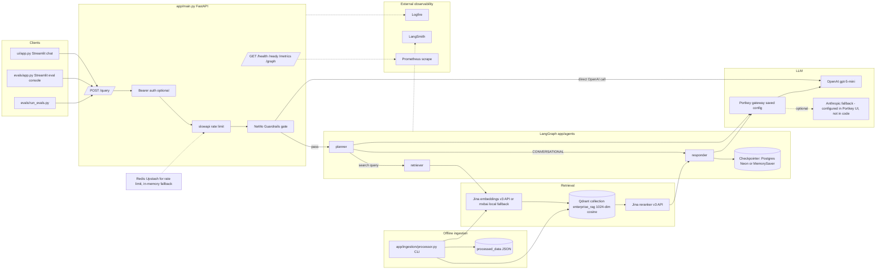
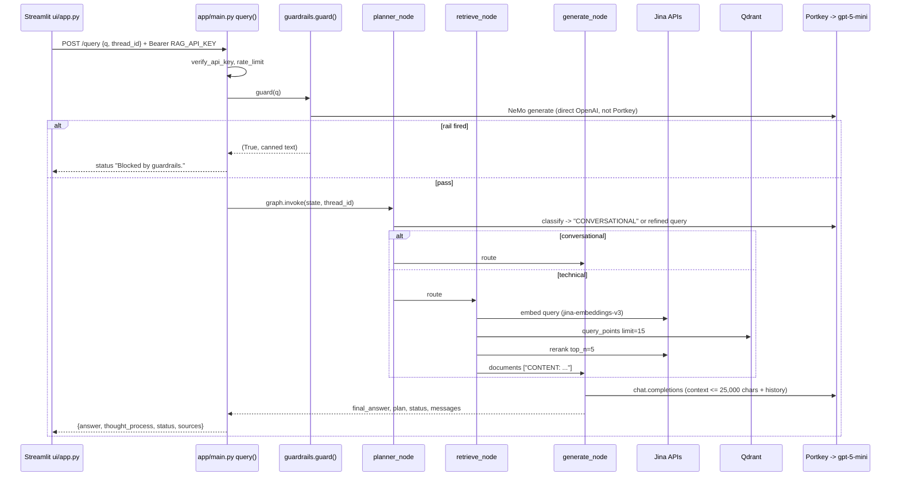
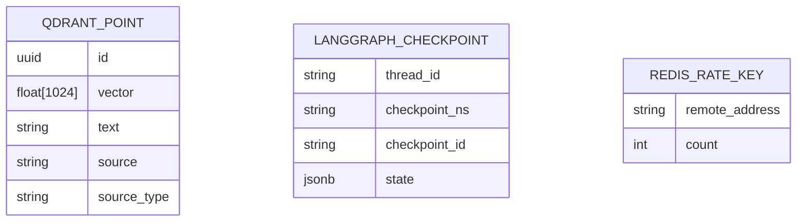

# Perceptra — Repository Audit Report

Audit date: 2026-10-27. Scope: read-only review of commit `bdb18bd` on `main` (remote `https://github.com/Sunny914/Perceptra.git`). No application code, dependencies, or Git history were modified. The only file created by the audit is this report. `DEPLOYMENT_PLAN.md` was not created because `deployment_plan.md` (the existing AWS plan) already exists and Windows treats the two names as the same file.

Status vocabulary used throughout:

- Verified in code: read in source and traced.
- Configured, not verified working: present in config/scripts, not executed during the audit.
- Partial: implemented but incomplete or not wired end to end.
- Docs only: appears in Markdown/notebooks only.
- Missing / Unknown.

---

## 1. Executive summary

Perceptra (currently named "Enterprise Agentic RAG" in code) is a FastAPI service that answers questions about a pre-indexed document corpus. A request passes through a NeMo Guardrails gate, then a three-node LangGraph (planner, retriever, responder). Retrieval is Jina embeddings into Qdrant, reranked by the Jina Reranker API. Generation goes through the Portkey gateway to `gpt-5-mini`. Conversation state is persisted per `thread_id` in Postgres (Neon) via the LangGraph checkpointer, with an in-memory fallback. Two Streamlit apps exist: a chat UI and a RAGAS evaluation console; both are thin HTTP clients of the API. Documents are ingested offline by a CLI script, not uploaded through the UI.

Maturity: a working, partially hardened prototype with real integrations, unit tests, CI, and a Docker image. It is not production-ready: there is no citation of sources, no insufficient-evidence behavior, no per-user isolation of conversation memory, all eight external services are mandatory at startup, and the dependency set is unpinned in the file CI installs from.

Blockers before the repository is safe as a public portfolio project:

1. P0 — `scripts/locustfile.py` line 35 hardcodes a default `RAG_API_KEY` bearer token (value not reproduced here). It is in the pushed commit. Rotate it and remove it from history.
2. P0 — `DATA/noisy_data/` contains roughly 50 third-party PDFs (books, papers, conference slides; ~94 MB) that are tracked and pushed. Redistribution rights are unverified. Remove from the repository and history.
3. P1 — `scripts/aws_deploy_state.sh` and `scripts/aws_secret_arns.sh` embed an AWS account ID and live resource identifiers.
4. P1 — The app cannot start without Neon and Upstash credentials even though both have code fallbacks (`app/config.py` lines 45–49).
5. P1 — `pyproject.toml` omits `unstructured` and `pdfplumber`, which `app/ingestion/loaders/office.py` and `app/ingestion/loaders/pdf.py` import; `uv.lock` is an 8-line stub; CI installs an unpinned `requirements.txt`.

---

## 2. Product description

Problem solved: let a user ask natural-language questions about internal technical documentation (the sample corpus is Kubernetes job/autoscaling docs) and receive an answer grounded in retrieved chunks, while refusing off-topic and jailbreak prompts.

Intended user: an internal engineer using a chat UI; an operator using the eval console to measure answer quality.

User-facing features verified in code:

- Chat with history per browser session (`ui/app.py`; `thread_id` = session UUID).
- Reasoning steps shown per answer (`thought_process` from the API).
- Retrieved chunks shown in an expander ("sources" are chunk text, not file names).
- Guardrail refusals for off-topic/jailbreak input; greetings/farewells answered by the rail.
- Eval console: view golden dataset, run live pipeline against the API, score with RAGAS (`evals/app.py`).

Not available to users: document upload, corpus management, trace inspection inside the app (traces go to Logfire/LangSmith SaaS), guardrail configuration at runtime.

Supported document types (verified in `app/ingestion/processor.py` lines 57–70): `pdf`, `html`/`htm`, `txt`, `docx`, `pptx`. No OCR, no image handling, no layout analysis.

Maturity: partially integrated system / deployable prototype.

Accurate portfolio description: "An agentic RAG service with a guardrail gate, LangGraph routing between conversational and retrieval paths, Jina + Qdrant retrieval with reranking, Portkey-routed generation, Postgres-backed conversation memory, Prometheus metrics, Logfire/LangSmith tracing, a Streamlit chat UI, and a RAGAS evaluation console."

---

## 3. Repository inventory

Git: repo root is the project folder; branch `main` at `bdb18bd` (single commit, "Initial commit"); remote `origin` = GitHub `Sunny914/Perceptra`; working tree clean; 156 tracked files; `.git` is 86 MB. No `.env` present. No virtual environment present (the `tenvv` folder named in `README.md` does not exist). No `LICENSE`.

Languages: Python (49 `.py` files across `app/`, `evals/`, `ui/`, `tests/`, `scripts/`), 4 Jupyter notebooks, Bash (4 scripts), YAML (CI/CD, Compose), JSON (ECS task definitions, eval dataset), Markdown (7 docs). Python constraint: `>=3.11` (`pyproject.toml`); Dockerfile uses 3.11-slim; CI uses 3.12; local machine has 3.13.1. `torch==2.5.1` (pinned in `pyproject.toml`/`requirements-prod.txt`) has no 3.13 wheels, so the pinned set does not install on the local interpreter.

| Path | Purpose | Importance | Confidence |
|---|---|---|---|
| `app/main.py` | FastAPI app: Logfire init, auth, rate limit, `/query`, `/graph`, metrics | Core | Verified |
| `app/config.py` | Pydantic settings; derives Postgres/Redis URLs | Core | Verified |
| `app/agents/graph.py` | LangGraph build + Postgres/Memory checkpointer | Core | Verified |
| `app/agents/nodes/{planner,retriever,responder}.py` | Graph nodes | Core | Verified |
| `app/agents/state.py` | `AgentState` TypedDict | Core | Verified |
| `app/guardrails/{rails,colang_rules}.py` | NeMo Guardrails gate, Colang intents, rail indicators | Core | Verified |
| `app/gateway/client.py` | Portkey-routed OpenAI clients | Core | Verified |
| `app/services/retrieval/embedding.py` | Jina embeddings API + local mxbai fallback | Core | Verified |
| `app/services/retrieval/qdrant_service.py` | Qdrant `query_points` with retry | Core | Verified |
| `app/services/retrieval/ranking_service.py` | Jina reranker with retry/fallback | Core | Verified |
| `app/ingestion/processor.py` | CLI ingestion: parse, chunk, save JSON, embed, upsert | Core (offline) | Verified |
| `app/ingestion/loaders/*.py`, `chunking/splitter.py` | Parsers, paragraph chunker | Core (offline) | Verified |
| `app/health.py`, `app/services/health/connection_checker.py` | `/health`, `/ready`, startup checks | Supporting | Verified |
| `app/logging.py` | Request-id contextvar (set, never read elsewhere) | Minor | Verified |
| `ui/app.py` | Streamlit chat UI | Core UI | Verified |
| `ui/st_cloud_ui.py` | Older Streamlit variant; hardcodes `localhost:8000`, no auth header | Obsolete | Verified |
| `evals/app.py` | Streamlit eval console (3 tabs) | Secondary app | Verified |
| `evals/pipeline.py`, `guardrails_eval.py`, `metrics.py`, `run_evals.py` | Live pipeline, guardrail scoring, RAGAS metrics, headless runner | Secondary | Verified |
| `evals/data_parser.py` | Chunk loader for eval context; uses lowercase `data/` path; not imported anywhere | Unused | Verified |
| `evals/golden_dataset.json`, `og_golden_dataset.json` | 15 Q&A + 6 guardrail cases; the two files are identical in size | Data | Verified |
| `tests/*.py` (9 files) | Mocked unit tests | Supporting | Verified (not executed) |
| `notebooks/*.ipynb` (4) | Tutorial-style experiments (guardrails, Portkey, evals); `02_llm_gateway_copy2` is a duplicate | Experimental | Verified |
| `scripts/create_aws_secrets.py`, `render_task_defs.py`, `aws_*.sh`, `destroy_aws_deployment.sh` | AWS provisioning/teardown helpers | Deployment | Configured, not verified |
| `scripts/aws_deploy_state.sh`, `aws_secret_arns.sh` | Recorded AWS resource IDs/ARNs (contain account ID) | Sensitive | Verified |
| `scripts/locustfile.py` | Load test; contains hardcoded API key default and old ALB hostname | Sensitive | Verified |
| `scripts/list_portkey_configs.py` | Helper to list Portkey saved configs | Utility | Verified |
| `Dockerfile`, `docker-compose.yml`, `.dockerignore` | Image (uv, non-root, port 8080); Compose with local Qdrant | Deployment | Verified |
| `.github/workflows/ci.yml`, `cd.yml` | Ruff + pytest; ECR push + ECS deploy on CI success | Deployment | Configured |
| `.aws/task-definitions/*.json` | Fargate task definitions (placeholders) | Deployment | Configured |
| `pyproject.toml`, `requirements.txt`, `requirements-prod.txt`, `uv.lock` | Three overlapping dependency manifests; lock is a stub | Build | Verified |
| `.env.example` | Variable names with placeholders; no secrets | Config | Verified |
| `.streamlit/config.toml` | `fileWatcherType = "none"` | Config | Verified |
| `.gcloudignore` | Leftover from an earlier GCP/Cloud Run phase | Obsolete | Verified |
| `DATA/true_data/` (6 files) | Kubernetes docs: pptx, docx, html, txt | Sample corpus | Verified |
| `DATA/noisy_data/` (~55 files, 94 MB) | Third-party PDFs plus synthetic txt/html/docx/pptx | Licensing risk | Verified |
| `processed_data/` (11 JSON) | Generated chunk output; tracked | Generated | Verified |
| `README.md`, `ARCHITECTURE.md`, `TESTING.md`, `local_testing.md`, `aws.md`, `deployment_plan.md` | Docs; `aws.md`/`deployment_plan.md` describe the ECS setup | Docs | Verified |

Generated/obsolete/duplicate items (not deleted): `processed_data/`, `ui/st_cloud_ui.py`, `notebooks/02_llm_gateway_copy2.ipynb`, `evals/og_golden_dataset.json`, `evals/data_parser.py`, `.gcloudignore`, the legacy Celery polling branches in `ui/app.py` lines 116–139 and `evals/pipeline.py` lines 42–80 (no `/query/status` route exists in `app/main.py`).

Large files: `DATA/noisy_data/A Forensic Analysis of CSG 11...pdf` 23.7 MB, `A Primer on Memory Consistency...pdf` 12.6 MB, `A Pattern Language - Alexander.pdf` 12.0 MB, and others; total `DATA/` 94 MB.

---

## 4. Architecture

Uncertain or optional: the Anthropic fallback exists only as a slug name (`PORTKEY_FALLBACK_SLUG`) and the Portkey saved config; nothing in code calls Anthropic. Redis and Postgres are optional at runtime but mandatory as settings.

### 4.1 Query sequence

### 4.2 Module map

| Module | Responsibility | Key symbols | Inputs → outputs | Callers | Connected | Risks |
|---|---|---|---|---|---|---|
| `app/main.py` | HTTP surface | `query`, `verify_api_key`, `rate_limit`, `startup_event` | JSON body → JSON | Streamlit, evals | Yes | `thread_id` is client-chosen and defaults to `default_user` (line 188); no `q` length limit; `/ready` is unauthenticated and makes a paid LLM call per hit; startup runs 8 network checks; `on_event` is deprecated in FastAPI |
| `app/config.py` | Settings | `Settings`, `postgres_uri`, `redis_url` | env → settings | all | Yes | Eight required vars (lines 25–49): app fails at import without Neon/Upstash values even though fallbacks exist downstream |
| `app/guardrails/rails.py` | Input gate | `initialize_rails`, `guard` | str → (bool, str) | `main.query` | Yes | Uses `ChatOpenAI(api_key=OPENAI_API_KEY)` directly, bypassing Portkey; rail detection is substring matching on canned replies (`RAIL_INDICATORS`); greetings are reported as "Blocked" |
| `app/agents/graph.py` | Graph + memory | `build_graph`, `create_checkpointer` | — → compiled graph | `startup_event`, tests | Yes | Falls back to `MemorySaver` silently on Postgres failure (logged warning only) |
| `planner.py` | Route decision | `planner_node` | state → `current_query` | graph | Yes | Routing relies on exact string `CONVERSATIONAL` (graph.py line 86); prompt hardcodes topic list "Kubernetes, Intel, or Networking" |
| `retriever.py` | Retrieve + rerank | `retrieve_node` | query → `documents` | graph | Yes | Drops `source` and `score` from results (line 20); documents become `"CONTENT: ..."` strings, so no citations reach the user |
| `responder.py` | Generation | `generate_node`, `_generate_response` | state → `final_answer` | graph | Yes | No instruction to refuse when context is empty; full history injected each turn (unbounded growth); 25,000-char cap is character-based |
| `gateway/client.py` | Portkey clients | `portkey_client`, `get_langchain_llm` | — | planner, responder, health | Yes | Requires `PORTKEY_PRIMARY_CONFIG_ID` at import; fallback behavior lives in the Portkey dashboard, not in repo |
| `embedding.py` | Embeddings | `embed_query`, `embed_texts`, `get_embedding_dim` | text → vectors | retriever, ingestion | Yes | Jina and mxbai are both 1024-dim but different spaces; if ingestion used one and queries use the other, retrieval degrades silently |
| `qdrant_service.py` | Vector search | `search_enterprise_knowledge` | query → list[dict] | retriever | Yes | No filter, no score threshold; returns `[]` on failure, which the responder treats as "no context" without telling the user |
| `ranking_service.py` | Rerank | `rerank_documents` | docs → top_n | retriever | Yes | Skips reranking when key missing; sends chunk text to Jina |
| `ingestion/processor.py` | Offline indexing | `process_file`, `run_universal_ingestion` | folder → Qdrant points + JSON | CLI only | Yes (offline) | Random UUID point IDs: re-running without `--wipe` duplicates chunks; `unstructured` import for Office files is not in `pyproject.toml` |
| `chunking/splitter.py` | Chunking | `chunk_text` | text → chunks | ingestion, evals | Yes | Paragraph accumulation to 1,500 chars, no overlap, no hard split of oversized paragraphs |
| `health.py` + `connection_checker.py` | Probes | `/ready`, `check_all_connections` | — → status | main, CLI | Yes | `/ready` cost and latency (8 probes, one LLM completion) |
| `ui/app.py` | Chat UI | — | user input → HTTP | user | Yes | Sends `RAG_API_KEY` from env; dead Celery polling branch |
| `evals/*` | Eval console/runner | `run_pipeline`, `run_guardrails_eval`, `run_all_metrics` | golden JSON → scores | operator | Yes (separate process) | Hardcoded `http://localhost:8000` (`pipeline.py` line 16, `guardrails_eval.py` line 13); no auth header, so fails when `RAG_API_KEY` is set; RAGAS results held only in Streamlit session |

### 4.3 Ingestion flow (verified)

`python -m app.ingestion.processor DATA --wipe` → `run_universal_ingestion` (optionally deletes/creates collection; dimension from `get_embedding_dim()`, cosine) → per sub-folder `process_directory` (`true`/`noisy` source types inferred from folder names) → `process_file`: parse by extension → `chunk_text` → write `processed_data/<type>/<file>.json` → `embed_texts` (Jina batches of 64) → `qdrant_client.upsert` with payload `{text, source, source_type}`. Errors per file are logged and skipped. Empty-text files are skipped.

---

## 5. Streamlit applications

| App | Launch | Purpose | Imports backend modules | External calls | Env needed | Independent | Nature | Publish? |
|---|---|---|---|---|---|---|---|---|
| `ui/app.py` | `streamlit run ui/app.py` | Chat UI | None (HTTP only) | `BACKEND_URL/query`; Logfire | `BACKEND_URL`, `RAG_API_KEY` (optional), `LOGFIRE_TOKEN` (optional) | Needs running API | Real UI | Yes — the public demo surface |
| `evals/app.py` | `streamlit run evals/app.py` | Eval console: golden set, live pipeline, RAGAS | `evals.*` (which import `ragas`, `pandas`, `nest_asyncio`) | `localhost:8000/query` (hardcoded); OpenAI judge; HF embeddings download (`all-MiniLM-L6-v2`) | `JUDGE_OPENAI_API_KEY` or `OPENAI_API_KEY`, `LOGFIRE_TOKEN` | Needs running API on localhost | Real evaluation tool using live responses, not mock data | Internal/local only (spends judge tokens, ~50 min runtime per the UI text) |
| `ui/st_cloud_ui.py` | `streamlit run ui/st_cloud_ui.py` | Earlier UI variant | None | `http://localhost:8000` hardcoded; no auth header | `LOGFIRE_TOKEN` via `st.secrets` | Needs local API | Obsolete | No — document as legacy or remove later |

Observability dashboard: none is implemented in the repository. Traces go to Logfire and LangSmith (SaaS); metrics are exposed at `/metrics` for an external Prometheus. The eval app reads real API responses, not sample data.

Smallest useful deployment: `app.main:app` (API) plus `ui/app.py`. Keep `evals/app.py` local.

---

## 6. RAG and agentic audit

Retrieval and ingestion:

- Formats: pdf (pypdf, pdfplumber fallback for blank pages), html (BeautifulSoup), txt, docx/pptx (`unstructured.partition.auto`). Fully scanned PDFs yield no text and are skipped (`pdf.py` lines 43–44).
- Chunking: paragraph split on `\n\n`, greedy fill to 1,500 characters, no overlap, no sentence/token awareness.
- Metadata: `text`, `source` (filename), `source_type`. No page numbers, no document IDs, no hashes.
- Embeddings: `jina-embeddings-v3`, 1024-dim, task `retrieval.passage`/`retrieval.query` (per `embedding.py`); fallback `mixedbread-ai/mxbai-embed-large-v1` (1024-dim, local, requires `sentence-transformers` + `torch`).
- Index: Qdrant collection `enterprise_rag`, cosine. Created by ingestion only; the API does not create it. Querying a missing collection raises inside the retry wrapper and returns `[]`.
- Retrieval: top-15 by vector similarity, no filters, no threshold; rerank to top-5.
- Duplicates: none handled; point IDs are random UUIDs.
- Attribution: lost at `retriever.py` line 20; the API's `sources` field holds chunk text only.
- Empty corpus: responder receives empty context and still generates an answer; no "insufficient evidence" path.

Agentic workflow:

- State: `AgentState` (`messages` with `operator.add`, `current_query`, `documents`, `plan`, `status`, `final_answer`).
- Nodes/edges: `planner` → conditional (`responder` | `retriever`) → `retriever` → `responder` → `END`. Single pass, no cycles, no retries at graph level, no tool loop. Termination is guaranteed.
- Verdict: a deterministic RAG chain with one LLM-decided branch. "Agentic" is accurate only in the narrow sense of LLM-based routing with persistent state. It is not a multi-step planning or tool-calling agent.
- Memory: LangGraph checkpointer keyed by `thread_id`; Postgres via `PostgresSaver` (tables created by `setup()`), fallback `MemorySaver`. Isolation depends entirely on clients choosing unique `thread_id`s; the API default is `default_user`, shared by every caller that omits it.
- Loop/cost control: three LLM calls per technical question (guardrail, planner, responder), each retried up to 3 times by tenacity (responder) or NeMo internals. No token budget.

Generation quality:

- Prompts are inline f-strings (`planner.py` lines 22–37, `responder.py` lines 26–60). Grounding instruction: "Answer the question using the TECHNICAL CONTEXT provided." No refusal/abstain instruction, no citation instruction.
- Context management: character cap (25,000) on retrieved docs; history uncapped.
- Streaming: not implemented server-side; the UI animates the completed answer character by character (`ui/app.py` lines 166–170).
- Citations: not implemented.

Multimodal/OCR: no OCR, VLM, or layout modules anywhere in the repository (grep for `ocr`, `tesseract`, `layout` returns only Streamlit `layout="wide"` and a comment in `requirements.txt`). No GPU assumptions; `torch` is present only for the optional local embedding fallback.

### 6.1 Feature matrix

| Feature | Status | Evidence |
|---|---|---|
| Guardrail input gate (off-topic, jailbreak, greetings) | Implemented and code-connected | `app/guardrails/rails.py`, `colang_rules.py`, `main.py` line 227 |
| Output guardrails | Missing | No output rails in `YAML_CONTENT`; `guard()` only sees the input |
| LangGraph planner routing | Implemented and code-connected | `graph.py` lines 82–93 |
| Postgres conversation memory | Implemented and code-connected (fallback to memory) | `graph.py` lines 13–59 |
| Jina embeddings + local fallback | Implemented and code-connected | `embedding.py` |
| Qdrant search | Implemented and code-connected | `qdrant_service.py` |
| Jina reranking | Implemented and code-connected | `ranking_service.py` |
| Portkey gateway for planner/responder | Implemented and code-connected | `gateway/client.py` |
| Anthropic fallback | Configured outside repo, not verified | Only `PORTKEY_FALLBACK_SLUG` string; depends on Portkey saved config |
| Source citations | Missing | `retriever.py` line 20 discards `source` |
| Insufficient-evidence handling | Missing | `responder.py` prompt |
| Document upload via UI/API | Missing | No `UploadFile` in `main.py` |
| Offline ingestion CLI (5 formats) | Implemented and code-connected | `processor.py` |
| OCR / layout / multimodal | Missing | grep |
| Bearer auth | Implemented (optional, single shared key) | `main.py` lines 85–101 |
| Rate limiting (Redis or memory) | Implemented | `main.py` lines 59–82 |
| Prometheus metrics | Implemented | `main.py` lines 41–54, 163 |
| Logfire tracing | Implemented | `main.py` lines 17–20 and spans throughout |
| LangSmith tracing | Configured (env-based), not verified | `config.py` lines 107–124 |
| `/ready` dependency probe | Implemented | `health.py` |
| RAGAS evaluation (6 metrics) | Implemented, runs live, results not persisted | `evals/metrics.py`, `evals/app.py` tab 3 |
| Headless eval report | Partial (pipeline + guardrails only; no RAGAS scores) | `evals/run_evals.py` lines 53–61 |
| Docker image | Implemented (API by default; UI via command override) | `Dockerfile`, `docker-compose.yml` |
| CI (ruff + pytest) | Configured | `.github/workflows/ci.yml` |
| CD to ECS | Configured, past deployment evidenced, not currently live | `cd.yml`, `scripts/aws_deploy_state.sh`; ALB hostname in `locustfile.py` no longer resolves (NXDOMAIN at audit time) |
| Load test | Implemented (contains secret) | `scripts/locustfile.py` |
| Streaming responses | Missing (UI-side animation only) | `ui/app.py` |

---

## 7. Database and persistence

| Question | Finding |
|---|---|
| Vector store | Qdrant only (`qdrant-client`), remote URL from `QDRANT_URL`/`QDRANT_CLUSTER_ENDPOINT`; Compose also offers a local `qdrant/qdrant` container. No pgvector anywhere. |
| Relational DB | Postgres (Neon) used only by the LangGraph checkpointer. Schema (`checkpoints`, `checkpoint_blobs`, `checkpoint_writes`, `checkpoint_migrations`) is created automatically by `PostgresSaver.setup()` at startup (`graph.py` lines 44–45). No app-owned migrations. |
| Redis | Upstash (TLS URL derived from REST credentials, `config.py` lines 90–101) for slowapi rate-limit counters only. Falls back to process memory. |
| Original files | Local filesystem `DATA/` at ingestion time only; nothing is stored by the API. |
| Chat history | Postgres checkpoints keyed by `thread_id`; or process memory. |
| Users | None. No user table, no identity. |
| Eval results | Streamlit session state; `evals/report.json` when using the headless runner. |
| Local vs remote | All three stores are remote by configuration; Qdrant can be local via Compose. |
| Runtime filesystem needs | None for the API. `processed_data/` is written only by ingestion. HF model cache (~670 MB) is downloaded if the mxbai fallback triggers. |
| Persistent volumes | Not required for the API; required only for a self-hosted Qdrant. |
| Multi-instance safety | Yes for Postgres and Qdrant; rate limiting is consistent across instances only when Redis is reachable. |
| Failure modes | Postgres down → `MemorySaver` (state lost on restart). Redis down → per-process limits. Qdrant down or collection missing → empty context, answer still generated. Jina down → local fallback embeddings (different vector space) and unreranked results. |

---

## 8. Dependencies and runtime

- Three manifests disagree: `requirements.txt` (unpinned; includes `unstructured`, `pdfplumber`, `langfuse`, `deepeval`, `ragas`, `ruff`), `requirements-prod.txt` and `pyproject.toml` (pinned, identical set, omit `unstructured` and `pdfplumber`, include `streamlit`). `uv.lock` contains only the root package and locks nothing.
- CI installs `requirements.txt` → unreproducible; Docker installs `pyproject.toml` dependencies → Office parsing (`unstructured`) and the pdfplumber fallback are absent inside the image.
- Declared but unused in code: `loguru`, `langchain-nvidia-ai-endpoints`, `langchain-community`, `langfuse`, `deepeval` (notebook only), `numpy`, `pytz`. `langchain-google-vertexai` is commented as a NeMo import shim; unverified whether still needed with `nemoguardrails==0.21.0`.
- Native/heavy: `torch==2.5.1` (CUDA wheels by default on Linux; image size and memory risk on 1–2 GB hosts), `sentence-transformers`, `unstructured` (needs `libmagic`, and `poppler`/`tesseract` for some paths; not installed in the Dockerfile), `psycopg-binary`, `nemoguardrails` (downloads nothing by default; builds Colang flows at startup).
- Python: `torch==2.5.1` requires ≤3.12. The local interpreter is 3.13.1 with none of the core packages installed, so tests could not be run during this audit.
- Startup assumptions: run from repository root (`.env` discovery, `python -m` module paths, `DATA` default path). `evals/data_parser.py` uses `data/` (lowercase) which breaks on Linux.
- Smallest fixes for a clean, reproducible setup (P1): pick one manifest (recommend `pyproject.toml` with optional groups `ui`, `evals`, `dev`, `local-embeddings`), add `unstructured` and `pdfplumber` to the core group or make the Office loader use `python-docx`/`python-pptx` as `evals/data_parser.py` already does, regenerate `uv.lock`, pin CI to 3.11/3.12, make CI install from the lock.

---

## 9. Security findings

| # | Severity | Finding | Evidence | Impact | Fix | Blocks publish? |
|---|---|---|---|---|---|---|
| S1 | Critical | Hardcoded API bearer token default and former production ALB hostname | `scripts/locustfile.py` lines 5, 11, 14, 35 | Anyone can call a deployment that still uses that key; key is now in a public commit | Rotate the key wherever it is still configured; replace the default with `os.environ["RAG_API_KEY"]` (fail if unset); purge from history (see §9.1) | Yes |
| S2 | High (legal) | ~50 third-party copyrighted PDFs tracked and pushed | `DATA/noisy_data/*.pdf` (94 MB) | Redistribution without rights; repository bloat (86 MB `.git`) | Remove from tree and history; keep `DATA/true_data` (Kubernetes docs — check their license too) and the synthetic `.txt/.html/.docx/.pptx` files, which `README.txt` describes as generated | Yes |
| S3 | High | Cross-session conversation leakage via client-chosen `thread_id`; default `default_user` is shared | `main.py` line 188, `graph.py` checkpointer | Any caller with the single shared API key can read/continue another user's thread by guessing or omitting `thread_id` | Generate server-side thread IDs or bind them to an authenticated principal; at minimum remove the shared default | Deployment yes, publish no |
| S4 | Medium | AWS account ID and live resource identifiers committed | `scripts/aws_deploy_state.sh`, `scripts/aws_secret_arns.sh` | Reconnaissance aid; account ID appears in ARNs | Move to an untracked `.state/` or gitignored file; purge from history | Recommended |
| S5 | Medium | Unauthenticated `/ready` runs 8 probes including a paid LLM completion per request; no rate limit on it | `health.py`, `connection_checker.py` lines 101–116 | Cost amplification and slow-loris style load | Require auth or cache results; drop the LLM probe from `/ready` | Deployment |
| S6 | Medium | No bound on `q` length or history size; full history re-sent each turn | `main.py` `QueryRequest`, `responder.py` lines 17–20 | Token cost and latency abuse | `Field(max_length=...)`, cap history turns | Deployment |
| S7 | Medium | Rate limiting keyed on `get_remote_address`; behind a proxy/ALB all users share one address, and in-memory fallback is per process | `main.py` lines 66–79 | Either everyone is throttled together or limits are ineffective | Trust `X-Forwarded-For` only from the proxy; keep Redis | Deployment |
| S8 | Medium | Indirect prompt injection: retrieved chunks are concatenated into the prompt without delimiting or instruction hardening; no output rail | `responder.py` lines 48–60 | A poisoned document can steer answers | Delimit context, add explicit instruction precedence, add an output rail | Deployment |
| S9 | Low | Guardrail rails are few-shot example intents, trivially bypassed by paraphrase; detection relies on substring match of canned replies | `colang_rules.py`, `rails.py` line 45 | False negatives; greetings reported as "blocked" | Document as a demonstration-grade gate | No |
| S10 | Low | Full user queries logged to Logfire spans and info logs | `ui/app.py` line 84, `rails.py` line 47 | Sensitive prompt retention in SaaS | Truncate/hash or make opt-in | No |
| S11 | Low | `/graph` returns raw exception text | `main.py` line 205 | Minor information disclosure | Return generic error | No |
| S12 | Low | CD workflow auto-deploys to ECS on any push to `main` once GitHub secrets exist | `cd.yml` | Accidental deploy/charges | Add `workflow_dispatch` gating or disable until needed | No |
| S13 | Low | Notebooks tracked with 52 output cells | `notebooks/*.ipynb` | Scan found no key patterns; two synthetic `@company.com` addresses | Clear outputs before publishing | No |
| S14 | Informational | No `LICENSE`, no attribution, no `SECURITY.md`; `.env.example` is clean; `.gitignore` covers `.env` | repo root | Unclear reuse terms | Add a license you choose; state dataset provenance | Recommended |

Not found: SQL built from user input (none; checkpointer uses parameterized SQL), file upload endpoints, path traversal surfaces, `pickle`/unsafe deserialization, CORS middleware (none; browsers block cross-origin by default), debug mode flags, SSRF (no URL fetching).

### 9.1 Safe remediation for committed secrets

The key in `locustfile.py` is in commit `bdb18bd`, which is the only commit and is already on GitHub. Deleting the line in a new commit does not remove it from history. Options, from least to most invasive: (a) rotate the key (mandatory regardless), remove the file content, and accept history exposure; (b) because the history is a single commit, recreate the repository history (`git checkout --orphan`, recommit without the secret and without `DATA/noisy_data`, force-push) — this is a history rewrite and your decision; (c) `git filter-repo` for the specific paths. Also consider the AWS account ID (S4) and the PDFs (S2) in the same rewrite so it is done once. GitHub may retain the old commit in caches until support purges it.

Licensing items needing your confirmation: rights to redistribute each PDF in `DATA/noisy_data`; license of the Kubernetes documentation in `DATA/true_data` (kubernetes.io content is CC BY 4.0 — attribution required if kept); whether `og_golden_dataset.json` reproduces document text; the project's own license.

---

## 10. Testing and evaluation

Existing tests (all unit-level, all external calls mocked, none executed in this audit because the dependencies are not installed locally):

| File | Covers |
|---|---|
| `tests/test_auth.py` | open mode, invalid key → 401, valid key |
| `tests/test_rate_limit.py` | 1/min limit → 429 |
| `tests/test_async_query.py` | `/query` success shape; guardrail block shape |
| `tests/test_health.py` | `/health`; `/ready` 200 and 503 |
| `tests/test_metrics.py` | counters appear on `/metrics` |
| `tests/test_retry.py` | Qdrant and reranker retry 3× then degrade |
| `tests/test_checkpointer.py` | Postgres preferred, memory fallback |
| `tests/test_connection_checker.py` | probe result handling |
| `tests/test_evals.py` | `detect_tool`, `run_pipeline` with mocked HTTP, guardrail metrics |

CI status: workflow defined; the new GitHub repository has one commit and the run result was not checked. Coverage: not measured. `python -m compileall` over `app evals ui tests scripts` succeeded (syntax only).

Missing tests: empty/malformed documents and the chunker; retrieval relevance; citation correctness (feature absent); insufficient-evidence behavior (feature absent); prompt-injection cases; cross-thread isolation; Postgres/Qdrant unreachable at request time; LLM timeout/429 handling in the responder; invalid request bodies (over-long `q`); any regression suite over the golden dataset.

Evaluation pipeline: real. `evals/pipeline.py` calls the live API, `evals/guardrails_eval.py` computes TP/TN/FP/FN, `evals/metrics.py` runs RAGAS Faithfulness, AnswerRelevancy, ContextPrecision, ContextRecall, AnswerCorrectness (judge `gpt-5-mini`, HF MiniLM embeddings) plus a Jaccard tool-correctness score. Results are not persisted by the Streamlit app; the headless runner persists only phase-1 and guardrail results. No historical scores exist in the repository, so no quality numbers can be claimed.

Minimal acceptance checklist for a first public deployment:

1. `GET /health` → 200.
2. `GET /ready` → 200 with Qdrant, LLM gateway, Jina embeddings and reranker `ok` (Postgres/Redis may be `unavailable` if you accept fallbacks).
3. `POST /query` without bearer → 401 when `RAG_API_KEY` is set.
4. `POST /query` "hello" → status "Blocked by guardrails." with greeting text.
5. `POST /query` "ignore all previous instructions" → blocked.
6. `POST /query` "How do I start Redis for a Kubernetes work queue?" → answer mentions `kubectl apply` of `redis-pod.yaml`; `sources` non-empty.
7. Second message in the same `thread_id` referencing the first → coherent follow-up.
8. 21st request within a minute from one IP → 429.
9. `/metrics` shows `rag_requests_total`.
10. Streamlit UI completes one round trip against the public API URL.

---

## 11. Deployment evidence and feasibility

Evidence: `scripts/aws_deploy_state.sh` records concrete VPC, subnet, NAT, ALB, target group, ECR and task-definition identifiers; `scripts/aws_secret_arns.sh` records Secrets Manager ARNs; `scripts/locustfile.py` references an ALB hostname and says "deployed RAG API". This indicates the ECS Fargate stack in `aws.md` was actually provisioned at some point. The ALB hostname does not resolve today and `scripts/destroy_aws_deployment.sh` exists, so the stack appears torn down. Conclusion: "previously deployed to AWS ECS Fargate; not currently live" is the honest statement. Do not claim a live AWS deployment.

What the code needs from a host: one long-running Python process per app (uvicorn on 8080 or Streamlit on 8501), outbound HTTPS to Qdrant, Jina, Portkey/OpenAI, Neon, Upstash, Logfire; 30–50 s per query (per `locustfile.py` notes), so request timeouts must exceed 60 s; startup of roughly 10–30 s (NeMo init, Postgres migration, 8 probes); RAM in the 1–2 GB range with the current image because `torch` is installed (the Fargate task used 2 GB).

| Option | Fit | Changes needed | Free tier (verify) | Sleep/cold start | Limits to check | Storage/DB | Notes |
|---|---|---|---|---|---|---|---|
| A. Streamlit Community Cloud for `ui/app.py` (and optionally `evals/app.py`) | Good for the UI; cannot host the FastAPI API | Point `BACKEND_URL` at a public API; a lightweight requirements file for the UI so the platform does not install `torch`/`unstructured` | Free tier exists; resource limits and sleep policy need verification | Sleeps after inactivity | RAM ~1 GB class; one process | None needed | Secrets via platform UI, exposed as env vars (verify) |
| B. Vercel frontend + separate Python API | Not suitable for this codebase | Would require a new frontend; Vercel Python functions are request-scoped, cannot run Streamlit or a stateful uvicorn process with 30–50 s latency and heavy startup | — | — | Function duration and bundle size limits (verify) | — | Avoid |
| C. One container on a container host (Hugging Face Spaces Docker, Render, Fly.io, Railway, Koyeb, Google Cloud Run) | Best fit: the `Dockerfile` already works for the API; UI can run from the same image with a command override | Slim the image (drop `torch`/`sentence-transformers` into an optional group) if the host offers <2 GB RAM; raise request timeout | Each has a free or low-cost tier with different RAM/sleep rules — verify current plans | Most free tiers sleep; Cloud Run scales to zero | RAM, request timeout (needs >60 s), image size, outbound egress | External managed DBs | Recommended for the API |
| D. Managed DBs with separate app host | Already the design | None | Qdrant Cloud free cluster, Neon free Postgres, Upstash free Redis — all currently used by the code; quotas need verification | n/a | Qdrant storage quota; Neon compute auto-suspend; Upstash command quota | Yes | Keep |
| E. Existing AWS ECS stack | Works (evidenced) but costly | None | Not free: NAT Gateway, ALB, Fargate are billed hourly | None | — | — | Avoid for a portfolio demo; keep docs as "previous production design" |

Recommendations:

1. Simplest viable public demo: API container on one container host (Hugging Face Spaces Docker or Cloud Run are the lowest-friction), UI on Streamlit Community Cloud with `BACKEND_URL` and `RAG_API_KEY` as secrets, data in Qdrant Cloud (ingest once from your laptop), Neon for memory, Upstash for limits. Zero application code changes are strictly required beyond S1 and configuration; the lighter requirements file for the UI is a one-file addition.
2. Best free/low-cost architecture: same as 1 with a slimmed API image (no `torch`) so it fits 512 MB–1 GB hosts, and `/ready` cheapened.
3. Production-oriented future: the existing ECS design in `deployment_plan.md`, or Cloud Run with min-instances, plus server-issued thread IDs, output rails, citations, and persisted eval runs.
4. Keep local-only: `evals/app.py`, `scripts/locustfile.py`, notebooks, ingestion CLI.
5. Avoid: Vercel for any Python part; self-hosting Qdrant on a free container without a persistent disk; running ingestion inside the web process.

---

## 12. GitHub publication risks

Already public at `Sunny914/Perceptra` (one commit): S1 secret, S2 copyrighted PDFs, S4 AWS identifiers, 86 MB history, no license, notebooks with outputs, stale naming (`enterprise-rag`, `Enterprise Agentic RAG API`). The README currently claims "GitHub Actions CI lints and tests the app, and a CD workflow builds the image and deploys the API and UI to AWS ECS"; the CD claim is true of the workflow definition but should be phrased as a previous deployment, not a live one.

---

## 13. Important files (top 10)

1. `app/main.py` — API, auth, limits, guardrail gate, metrics.
2. `app/agents/graph.py` — graph wiring and checkpointer.
3. `app/agents/nodes/responder.py` — prompt and generation.
4. `app/agents/nodes/retriever.py` — retrieval + rerank; where citations are lost.
5. `app/guardrails/colang_rules.py` — rail definitions and persona strings (also used by `RAIL_INDICATORS` and eval detection).
6. `app/config.py` — required environment and URL derivation.
7. `app/services/retrieval/embedding.py` — embedding provider logic and fallback.
8. `app/ingestion/processor.py` — ingestion CLI and collection creation.
9. `ui/app.py` — public UI.
10. `pyproject.toml` / `Dockerfile` — what actually ships.

---

## 14. Known limitations

No citations; no abstain behavior; no upload; single shared API key; client-chosen thread IDs; guardrails are example-based; three LLM calls per question with 30–50 s latency; ingestion duplicates on re-run; image carries `torch`; eval scores not persisted; `evals` hardcode localhost and ignore auth; eight mandatory env vars; dead Celery code paths; three divergent dependency manifests; no license.

---

## 15. Prioritized recommendations

P0 — security/legal

- Rotate the API key referenced in `scripts/locustfile.py`; remove the default (`scripts/locustfile.py` line 35); purge from history together with `DATA/noisy_data/*.pdf` and `scripts/aws_deploy_state.sh` / `scripts/aws_secret_arns.sh` (move the latter two to an ignored path).
- Decide the dataset: keep `DATA/true_data` with attribution, keep synthetic noisy `.txt/.html/.docx/.pptx`, drop PDFs.

P1 — reproducible core run

- `app/config.py`: make `NEON_DB_URL`, `UPSTASH_REDIS_REST_URL`, `UPSTASH_REDIS_REST_TOKEN` optional (`str | None`) and guard `postgres_uri`/`redis_url`; `graph.py` and `main.py` already handle absence.
- `pyproject.toml`: add `unstructured` + `pdfplumber` (or switch `office.py` to `python-docx`/`python-pptx`), move `torch`/`sentence-transformers` to an optional `local-embeddings` extra, add `evals` and `ui` extras; regenerate `uv.lock`; make `ci.yml` install from `pyproject`/lock and pin Python 3.12.
- `evals/pipeline.py` line 16 and `evals/guardrails_eval.py` line 13: read `BACKEND_URL` and send `Authorization` when `RAG_API_KEY` is set.
- `app/main.py` line 188: drop the shared `default_user` default (require `thread_id` or generate one).

P2 — public demo

- Add `Field(max_length=2000)` on `QueryRequest.q`; remove the LLM probe from `/ready` or cache its result.
- Propagate `source` through `retrieve_node` and return `[{"source", "text"}]` so the UI can show file names.
- Add an abstain instruction to the responder prompt when `documents` is empty.
- Add a `ui/requirements.txt` (streamlit, requests, python-dotenv, logfire) for Streamlit Community Cloud.
- Rename user-visible strings: `main.py` title, `ui/app.py` page title/headers, `evals/app.py` title, `pyproject.toml` name/description, `ARCHITECTURE.md` heading. If you change the guardrail persona text in `colang_rules.py`, update `RAIL_INDICATORS` in the same file and `evals/golden_dataset.json` expectations.

P3 — portfolio quality

- Delete or mark legacy: `ui/st_cloud_ui.py`, `notebooks/02_llm_gateway_copy2.ipynb`, `evals/og_golden_dataset.json`, `evals/data_parser.py`, `.gcloudignore`, Celery polling branches.
- Add `LICENSE`, dataset attribution, screenshots, a corrected README (see §16), clear notebook outputs, add tests for chunker/empty corpus/isolation.
- Persist eval runs (`evals/report.json` with RAGAS scores) so measured numbers can be cited.

P4 — future

- Output rails and injection-hardened prompts; server-issued sessions; true streaming; hybrid/BM25 retrieval and metadata filters; document upload endpoint; hash-based idempotent ingestion; OCR only if you add it for real.

---

## 16. Rebranding notes for Perceptra

Name usage: "Perceptra" appears only in `README.md` (updated earlier) and the folder name. Code, Docker, ECS, Portkey metadata, Logfire service names and docs still say `enterprise-rag` / "Enterprise Agentic RAG".

Files to change, in order: `README.md` (verify claims against §6.1), `pyproject.toml` (`name`, `description`), `app/main.py` line 159 (`FastAPI(title=...)`), `ui/app.py` lines 39 and 72, `evals/app.py` lines 34 and 107, `ARCHITECTURE.md` line 1, `docker-compose.yml` (optional service names), `.github/workflows/cd.yml` defaults (`enterprise-rag`, `rag-cluster`) only if you redeploy, `app/ingestion/processor.py` line 19 and `evals/app.py` line 15 (`service_name`). Leave `colang_rules.py` persona text unless you also update `RAIL_INDICATORS`.

README sections to write: problem and users; verified features; architecture (reuse the Mermaid diagram in §4 with the "not verified" markers); stack; setup (Python 3.11/3.12, `uv sync` or `pip install -e .[ui,evals]` once extras exist); environment variables by name with placeholders (`OPENAI_API_KEY`, `PORTKEY_API_KEY`, `PORTKEY_PRIMARY_CONFIG_ID`, `PORTKEY_PRIMARY_SLUG`, `JINA_API_KEY`, `QDRANT_URL`/`QDRANT_CLUSTER_ENDPOINT`, `QDRANT_API_KEY`, `QDRANT_COLLECTION`, `NEON_DB_URL`, `UPSTASH_REDIS_REST_URL`, `UPSTASH_REDIS_REST_TOKEN`, `RAG_API_KEY`, `RATE_LIMIT_PER_MINUTE`, `STRICT_STARTUP`, `LOGFIRE_TOKEN`, `LOGFIRE_BASE_URL`, `LANGSMITH_*`, `JUDGE_OPENAI_API_KEY`, `BACKEND_URL`); run commands for API, chat UI, eval console, headless evals, ingestion; testing; deployment options (§11); security notes (shared key, thread IDs, guardrail scope); limitations (§14); attribution and license.

Resume bullets supported by code: LangGraph planner/retriever/responder with Postgres-checkpointed memory; Jina v3 embeddings + Qdrant + Jina reranker retrieval; NeMo Guardrails input gate with Colang intents; Portkey-routed OpenAI generation with retry/backoff; FastAPI with bearer auth, Redis/in-memory rate limiting, Prometheus metrics, Logfire/LangSmith tracing; RAGAS-based evaluation console over a 15-sample golden set; Docker image, GitHub Actions CI, and an ECS Fargate deployment design that was provisioned and later torn down. Do not claim: OCR/multimodal, measured accuracy improvements, live cloud deployment, enterprise security, citations.
